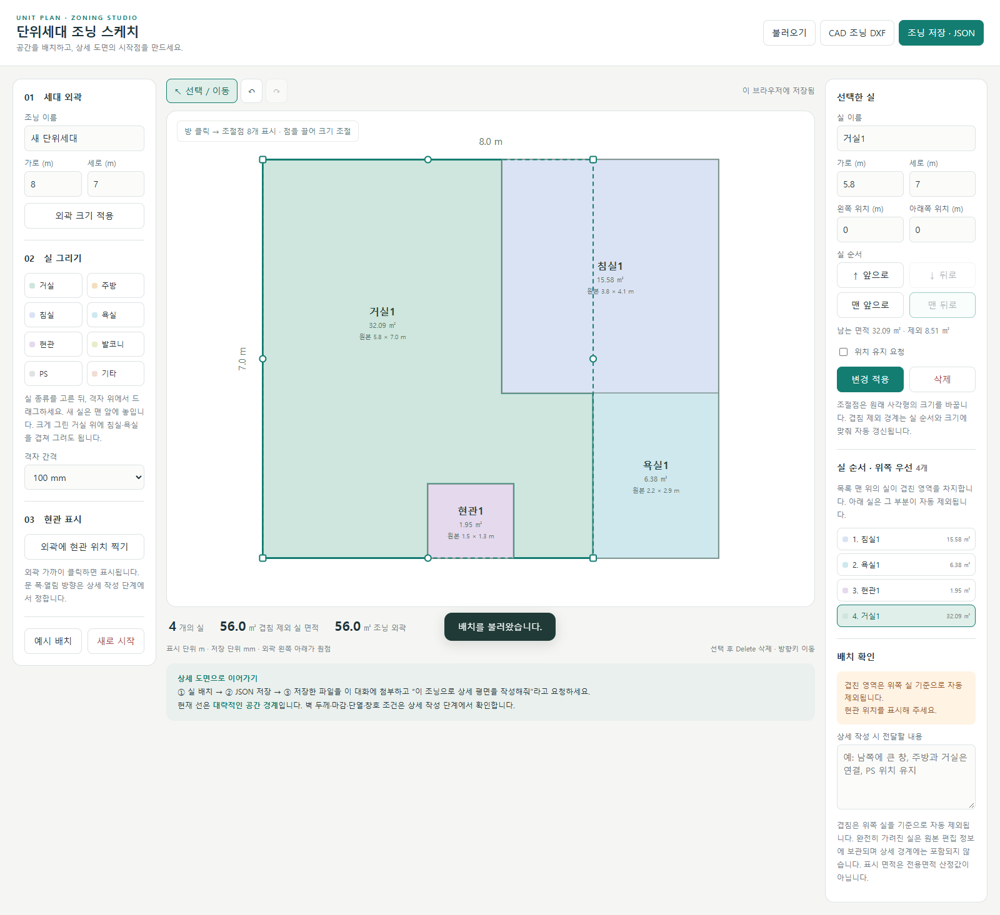

# 단위세대 조닝 스케치

브라우저에서 공동주택 단위세대의 실 배치(조닝)를 그리고 JSON·DXF로 저장하는 단일 HTML 편집기입니다. 설치 없이 `index.html` 하나로 동작하며, 저장한 JSON은 AI 에이전트가 상세 평면을 작성할 때 입력으로 씁니다.

**바로 쓰기:** https://share.planby.us/haemaru-week2/editor/



## 할 수 있는 것

- 세대 외곽 크기 지정 (m 단위 표시, mm 단위 저장, 외곽 왼쪽 아래가 원점)
- 실 종류(거실·주방·침실·욕실·현관·발코니·PS·기타)를 골라 격자 위에 드래그해서 그리기 · 격자 100/250/500mm
- 8개 조절점으로 크기 조절, 방향키 이동, Delete 삭제, 되돌리기/다시하기
- 앞뒤 순서(맨 앞으로 · 앞으로 · 뒤로 · 맨 뒤로): **앞에 놓인 실이 겹친 부분을 차지**하고 뒤의 실은 자동으로 차감
- 외곽에 현관 위치 표시
- 저장: **조닝 JSON**(schema `unit-zoning-editor/1.1`) · **CAD 조닝 DXF** · 불러오기 · 예시 배치
- 브라우저 자동 저장(localStorage) — 브라우저별로만 남으므로 JSON 저장을 꼭 하세요

## 저장되는 JSON (1.1)

| 필드 | 의미 |
|---|---|
| `room_regions` | 겹침을 뺀 **최종 실 영역**. 각 항목의 외곽(outer)에서 구멍(holes)을 뺀 것이 실제 형상이며, 여러 조각은 `room_id`로 같은 실에 묶입니다 |
| `entities` | DXF와 같은 선 정보 — 실 외곽(`ZONE_ROOM`), 내부 구멍(`ZONE_HOLE`), 실명 위치 |
| `editor.rooms` | 편집용 원본 사각형(뒤→앞 순서). 최종 CAD 경계로 다시 쓰지 않습니다 |
| `entry` · `units` · `boundary_semantics` | 현관 위치, 단위(mm), 경계의 의미(대략 조닝) |
| `wall_assemblies` · `opening_schedule` · `unresolved` | 벽 구성·창호는 비워 두고 상세 작성 단계에서 정합니다 |

`examples/`에 겹침이 있는 원본(`zoning-original.json`)과 겹침을 뺀 결과(`zoning-resolved.json`)가 있습니다.

표시 면적은 **조닝 면적**입니다. 마감 후 유효면적이나 법정 전용면적이 아닙니다. 선은 대략적인 공간 경계이며 벽 두께·마감·단열·창호는 다음 단계에서 정합니다.

## 상세 도면으로 이어가기

1. 실을 배치하고 **조닝 저장 · JSON**을 누릅니다.
2. 저장한 파일을 AI 에이전트(Codex, Claude Code) 대화에 첨부하고 “이 조닝으로 상세 평면을 작성해줘”라고 요청합니다.
3. CAD 작성 스킬: [yuxa94/unit-plan-cadcraft](https://github.com/yuxa94/unit-plan-cadcraft) (CADCraft MCP) — 입력 규칙은 그 저장소의 `references/input-contract.md`에 있습니다.

## 로컬에서 열기

```bash
git clone https://github.com/yuxa94/unit-zoning-sketch.git
```

`index.html`을 Chrome이나 Edge로 엽니다. 외부 라이브러리나 서버가 필요 없습니다.
